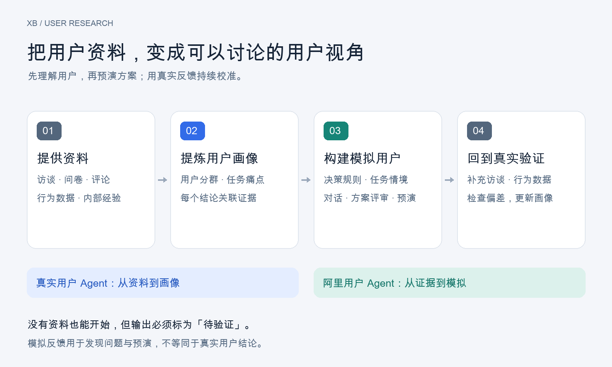
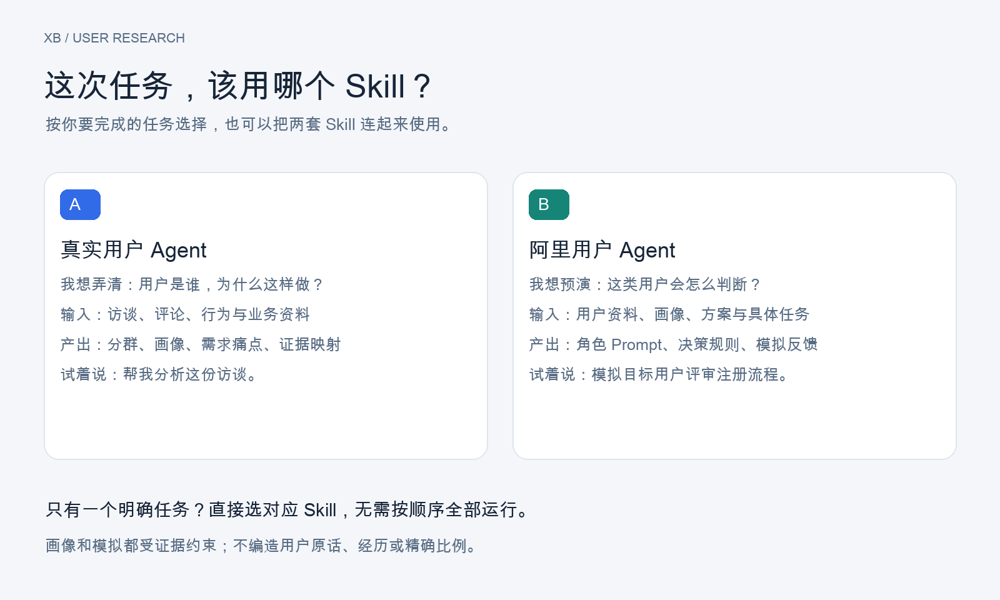

# XB User Research

**从用户资料中提炼画像，让有证据约束的模拟用户参与方案讨论。**

访谈、问卷、评论和行为数据散落在不同地方，怎样从中看出用户差异？有了画像，怎样让它参与具体的产品讨论？这个仓库提供两套互补的 AI Skill，分别帮助你完成这两件事。



## 它能帮你做什么

- **整理已有研究资料**：提取用户情境、目标、行为、痛点和替代方案，区分用户表达与实际行为。
- **识别有意义的用户差异**：按任务、阶段、能力、资源和决策角色形成候选分群，避免只按年龄、性别写画像。
- **让结论可追溯**：把关键判断关联到来源，标出证据不足、冲突与待验证假设。
- **预演产品方案**：构建有情境、决策规则和知识边界的模拟用户，让它对话、比较方案或解释顾虑。

适合需要整理用户资料、形成产品判断，或在真人研究前预演问题的产品、设计、研究与运营同学。

## 两个 Skill，怎么选



| | 真实用户 Agent | 阿里用户 Agent |
|---|---|---|
| 技术名称 | `evidence-user-agent` | `ali-user-agent` |
| 主要问题 | 用户是谁？有哪些差异、需求与痛点？ | 这类用户在这个情境下会怎样判断和行动？ |
| 常用输入 | 访谈、问卷、评论、行为数据、已有研究 | 用户资料、已有画像、产品方案、任务情境 |
| 主要产出 | 候选分群、画像、证据映射、研究建议 | 角色 Prompt、决策与行为规则、模拟反馈、校准案例 |
| 直接调用 | “用真实用户 Agent 分析这份访谈” | “用阿里用户 Agent 模拟目标用户评审这个方案” |

两者可以独立使用。需要连用时，先形成画像，再把画像、原始证据和具体任务一起交给阿里用户 Agent；后者也可以直接从已有资料开始构建。

## 安装

需要一个能加载本地 Skill 的 AI 工具，例如 Claude Code 或 Codex，以及本机 Git。Skill 本身没有额外的 API Key 或服务配置；资料检索与任务执行能力取决于你使用的工具。

### 1. 下载仓库

```bash
git clone https://github.com/Iris-lover/xb-user-research.git
cd xb-user-research
```

私有仓库需要先使用有权限的 GitHub 账号登录。也可以在 GitHub 页面通过 **Code → Download ZIP** 下载并解压。

### 2. 安装两个完整目录

根据工具选择一个目标目录：

| 工具 | 用户级 Skill 目录 |
|---|---|
| Claude Code | `~/.claude/skills/` |
| Codex | `~/.codex/skills/` |

把本仓库的 `evidence-user-agent/` 和 `ali-user-agent/` 两个文件夹复制到目标目录，保留各自的 `SKILL.md`、`references/` 和 `agents/`。已有同名文件夹时先备份；如果两个工具目录通过符号链接共用，安装一次即可。

安装后目录应类似：

```text
<你的 Skill 目录>/
├── evidence-user-agent/
│   ├── SKILL.md
│   ├── agents/openai.yaml
│   └── references/
└── ali-user-agent/
    ├── SKILL.md
    ├── agents/openai.yaml
    └── references/
```

### 3. 检查是否生效

重新开启工具会话，输入：

> 用真实用户 Agent 开始用户研究，先帮我盘点已有资料。

成功时，AI 应先盘点你能提供的资料，再补充缺失的产品、目标用户和研究问题，而不是直接编造完整画像。如果未加载，检查目录层级，或直接使用 `$evidence-user-agent` / `$ali-user-agent` 调用。

## 第一次使用：直接复制这些例子

下面是用法示例，**不是实际研究结果**。

### 场景一：把访谈整理成用户洞察

把资料附在同一会话，或提供工具能够读取的文件，再发送：

```text
用真实用户 Agent 分析我提供的访谈记录。

产品：面向自由职业者的记账工具
目标用户：刚开始独立接单的人
研究问题：为什么用户记了几天账就放弃？
资料：我提供的访谈记录和使用反馈

请先盘点资料覆盖与缺口，再提炼候选分群、任务、痛点和替代方案。
关键结论关联来源，区分用户表达、证据归纳和 AI 假设。
```

你会得到：资料概况、候选用户分群、画像、核心任务与需求、真实原话及来源、证据边界，以及下一步研究建议。样本不足时，分群与画像会保留为候选，不估算群体占比。

### 场景二：让模拟用户评审产品流程

```text
用阿里用户 Agent，基于我提供的用户资料与画像，
模拟一位刚开始接单的自由职业者，评审这个记账流程。

任务：记录一笔客户付款，再查看本月收入。
方案：见我提供的页面和流程说明。

先提炼这个用户的目标、能力、顾虑与决策规则，再模拟任务。
说明可能卡住的位置、继续或放弃的条件，并列出需要真人验证的问题。
资料不足的地方请明确标记，不虚构亲身经历。
```

你会得到：带证据边界的 Agent 档案、可复用的角色 Prompt，以及对指定情境的模拟反馈。模拟是否能直接操作页面，取决于当前 AI 工具的浏览器、应用和文件访问能力。

### 场景三：现在没有用户资料

```text
用真实用户 Agent 帮我研究一款面向自由职业者的记账工具。
我还没有访谈或行为数据，请先介绍可选的起步路径，让我选择。
```

可选路径包括行业资料检索、公开社群研究，或直接建立待验证画像。检索需按 Skill 流程确认范围与渠道；仅靠 AI 推断的内容会明确标记为假设。

## 怎么让结果更可靠

**提供资料 → 形成候选结论 → 预演任务 → 用真实反馈校准。**

- 提供资料的来源、时间和样本范围；移除不必要的个人与敏感信息。
- 用户“说了什么”和“实际做了什么”可能不同，两者都应保留。
- 新增访谈或行为数据后，要求 AI 更新画像与规则，记录变化和依据。
- 模拟反应用来发现问题、设计访谈和预演方案，不能据此声称真实转化率、市场规模或用户群体占比。

## 仓库结构

```text
xb-user-research/
├── README.md
├── assets/                    # README 的两张说明配图
├── evidence-user-agent/       # 真实用户画像与研究
│   ├── SKILL.md
│   ├── agents/openai.yaml
│   └── references/            # 首次调用、证据模型、画像结构
└── ali-user-agent/            # 情境模拟与用户 Agent
    ├── SKILL.md
    ├── agents/openai.yaml
    └── references/            # 首次调用、证据模型、Agent 结构
```

查看完整规则：[真实用户 Agent](evidence-user-agent/SKILL.md) · [阿里用户 Agent](ali-user-agent/SKILL.md)
